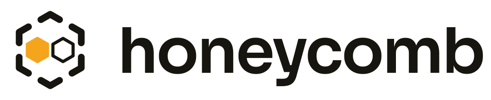

<p align="center">
  <picture>
    <source media="(prefers-color-scheme: dark)" srcset="assets/brand/logo-horizontal-dark.svg">
    
  </picture>
</p>

# honeycomb

**Cull your RAW+JPEG shoots in Nextcloud — fast, by touch, mouse or keyboard.**

honeycomb is a Nextcloud app for photographers who shoot RAW+JPEG and want to sort out a shoot
right where it is stored. It treats each RAW+JPEG pair as one picture: look at it once, decide
once, delete both files together. Optimised for desktop and tablet.


## Why honeycomb

- **One picture, not two files.** RAW and JPEG are paired by name; rate, label, flag and delete
  them as one.
- **Fast through thousands.** A smooth grid and a full-screen loupe with swipe, pinch zoom and
  keys, series of similar shots side by side, undo for every step.
- **digiKam-compatible XMP.** Stars, colour labels and tags go into standard XMP sidecars, so
  digiKam, darktable and Lightroom see your decisions.
- **Safe deleting.** Rejects are reviewed once more, then every file of the picture goes to the
  Nextcloud trash bin, where it can be restored.
- **Your data stays home.** Runs inside your Nextcloud, no telemetry, no outgoing requests; a
  cull started on one device goes on at the same place on another.

## Quick install

honeycomb is pre-release; it needs Nextcloud 35 and PHP 8.3. As an admin:

```sh
sudo -u www-data php /var/www/nextcloud/occ app:install honeycomb
```

Tarball install, recommended apps and updates: [installing](docs/user/admin/installing.md).
Keep a backup of photos you cannot replace: [your files and
privacy](docs/user/your-files-and-privacy.md).

## Learn more

- [User documentation](docs/user/README.md): culling a shoot, keys, sidecars, settings.
- [Admin documentation](docs/user/admin/README.md): installing, updating, removing.
- [Developer documentation](docs/README.md): how honeycomb is built, by AI agents under
  [`CLAUDE.md`](CLAUDE.md). Sister project: [Framehive](https://github.com/polandy/framehive),
  whose pairing and XMP rules honeycomb shares.

Report a security problem privately: [`SECURITY.md`](SECURITY.md). honeycomb is free software
under the [AGPL-3.0-or-later](LICENSE) and follows the [REUSE](https://reuse.software)
specification.
