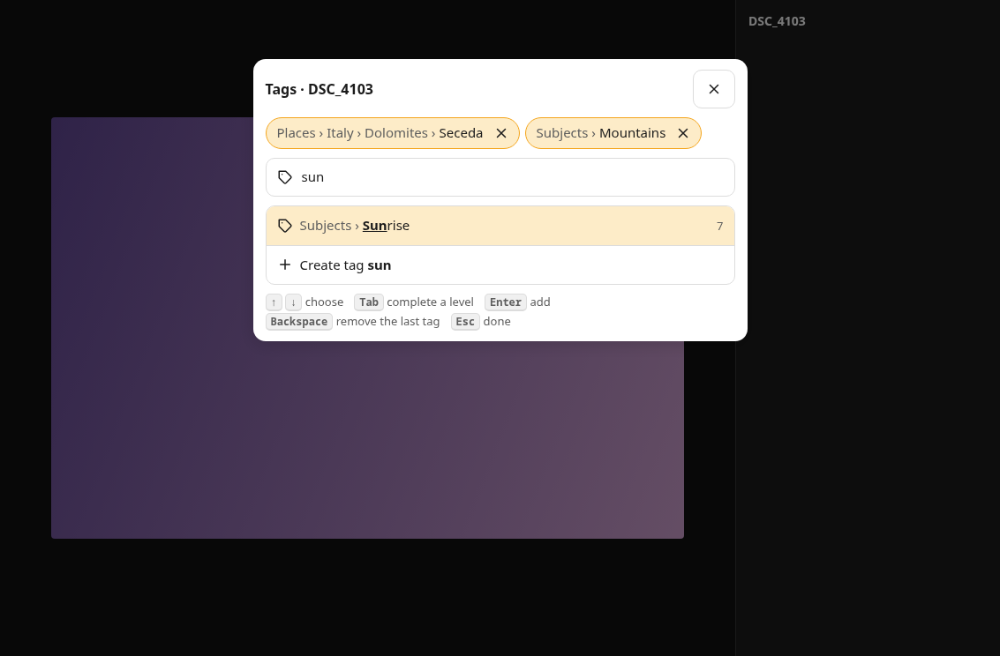
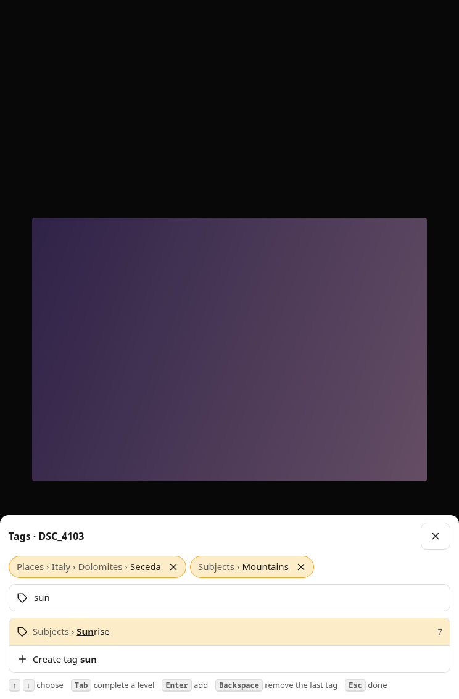
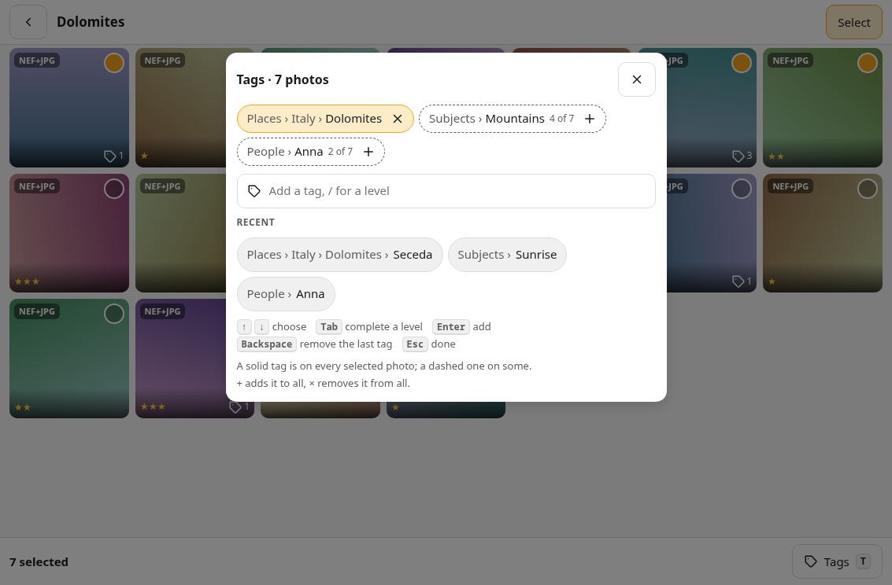
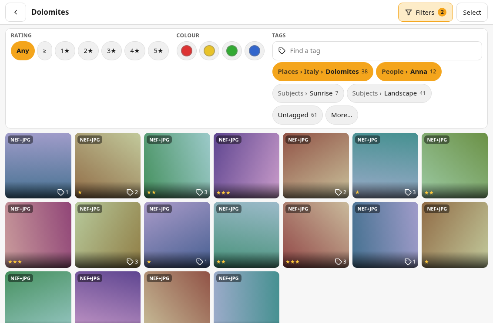
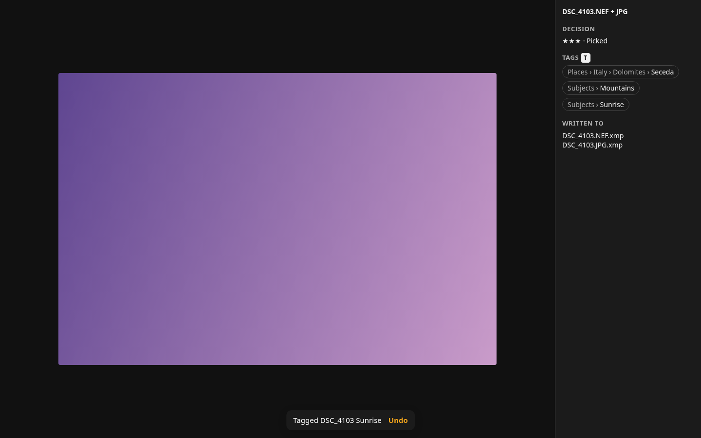

# 7. Tags (concept)

**Status: concept, nothing is built.** The owner asked for tags that work like digiKam's and are
read and written in digiKam's fields (2026-11-11). This document proposes how; the
[open owner decisions](#open-owner-decisions) must be answered before a milestone is planned.
The mockup is [`mockup/tags.html`](mockup/tags.html) (open it in a browser, no build); its
screenshots are in [`ux/tags/`](ux/tags/).

## Sources

digiKam at `cfd1ed79` (2026-11-11), paths under `core/`. Anything not checked there is marked
**unverified**. The rating, flag and colour-label fields stay as in
[`06-xmp-interop.md`](06-xmp-interop.md).

| Claim | Where |
|---|---|
| Read order and separators of the tag fields | `libs/metadataengine/dmetadata/dmetadatasettingscontainer.cpp:308–385` |
| Reading stops at the first field with values (`readingAllTags` off by default) | `dmetadata_tags.cpp:33–193`, `dmetadatasettingscontainer.cpp:240` |
| Writing: every field from the same list, replaced whole | `dmetadata_tags.cpp:195–380`, `libs/metadataengine/engine/metaengine_xmp.cpp:783, 882` |
| Only the assigned tags are written, not their parents; internal tags never | `libs/fileactionmanager/metadatahub.cpp:144–156, 471–541`, `libs/database/tags/tagscache.cpp:1027–1043` |
| Reading `a/b/c` creates `a`, `a/b`, `a/b/c` and assigns only `a/b/c` | `libs/database/item/scanner/itemscanner_photo.cpp:425–455` |
| `/` is not allowed in a tag name; typing `a/b` creates a level | `libs/album/manager/albummanager_talbum.cpp:352, 524`, `tagscache.cpp:668` |
| Writing modes and their default (*write to file only*) | `libs/metadataengine/engine/metaengine.h:59–68`, `metaenginesettingscontainer.cpp:44–52` |
| A sidecar, when read, replaces the file's embedded XMP | `metaengine_fileio.cpp:220–270`, `metaengine_p.cpp:1036–1045` |
| `T` is *Assign Tag* in the album view | `app/main/digikamapp_setup.cpp:320–325` |
| Tag entry completes by substring, ignoring case | `libs/tags/engine/tagscompleter.cpp:92–95` |
| Enter on a name: an existing tag of that name, else a new one | `libs/tags/engine/taggingactionfactory.cpp:410–465` |

## What digiKam does

**Fields.** digiKam reads these in order and **stops at the first that has a value**:

| # | Field | Holds | Separator | Array |
|---|---|---|---|---|
| 1 | `digiKam:TagsList` | full path | `/` | `rdf:Seq` |
| 2 | `MicrosoftPhoto:LastKeywordXMP` | full path | `/` | `rdf:Bag` |
| 3 | `lr:hierarchicalSubject` | full path | `\|` | `rdf:Bag` |
| 4 | `mediapro:CatalogSets` | full path | `\|` | `rdf:Bag` |
| 5 | `acdsee:categories` | full path | `/` | ACDSee XML |
| 6 | `dc:subject` | leaf name only | – | `rdf:Bag` |
| 7 | IPTC `Keywords` | leaf name only | – | – |

On writing it fills **every** field of this list from the item's tags, each replaced whole:
`dc:subject` and IPTC get the leaf names, the others the full path with their separator. A
keyword that is in `dc:subject` but not a tag is dropped. A tag path written is only the assigned
tag (`Places/Italy/Dolomites`), never its parents as separate entries.

**Where.** digiKam's *Metadata Writing Mode* is one of *write to file only* (the default),
*sidecar only*, *sidecar and file*, or *sidecar only for read-only files*. Sidecars are read only
with *Read from sidecar* on (off by default); then the sidecar's XMP replaces the file's
embedded XMP as a whole. RAW files are written only with *Write to RAW files* on (off by
default). So a default digiKam writes tags into the JPEG and keeps a RAW's tags in its
database; honeycomb's ratings and flags already need *Read from sidecar* on (Q2).

## Model

- A **tag** is a path of names, written `Places/Italy/Dolomites` as in `digiKam:TagsList`. A
  picture has a set of tags. Parents are not added: tagging `Places/Italy/Dolomites` does not
  tag `Places`, as in digiKam.
- A **name** is any text without `/` and `|`, trimmed, not empty; `|` is refused too because
  `lr:hierarchicalSubject` uses it. Two tags with the same leaf in different places
  (`People/Anna`, `Pets/Anna`) are different tags.
- Tags are stored like the other decisions (Q2 (c), ADR 0005): the database is the working
  state, read from the sidecars when a picture is first listed, and written through to its
  sidecars. A tag change is one undo step and one toast: "Tagged DSC_4103 Sunrise · Undo",
  "Tagged 7 photos Dolomites · Undo", "Removed Anna from 2 photos · Undo".
- The **tag list** offered by autocomplete and the filter is every tag read from the user's
  sidecars plus every tag the user created, kept per user. Tags no picture has any more stay
  in it, so a vocabulary built over years is not lost when a folder is culled empty (D6).

## Reading

From each sidecar honeycomb takes the tags of the **first** of these fields with a value, as a
default digiKam does: `digiKam:TagsList` (`/`), `lr:hierarchicalSubject` (`|`, a `/` inside a
name read as `\`, as digiKam does), `dc:subject` (each keyword a tag without parents). Fields 2,
4, 5 and IPTC are not read; digiKam, darktable and Lightroom always write one of the three.

**Several sources of one picture.** A pair has up to four: `IMG.NEF.xmp`, `IMG.JPG.xmp`,
the shared `IMG.xmp` and, if D1 says so, the JPEG's embedded XMP. Ratings and flags take the most
recently modified sidecar as a whole (`06-xmp-interop.md`). For tags the proposal is the
**union** of all sources (D2): tags are added in many places over the years, and dropping
the older sidecar's tags would lose work no other program shows the user. Writing then brings
every source to the same set, so a disagreement does not last.

## Writing

honeycomb writes the three fields it reads and leaves the others alone:

| Property | Value |
|---|---|
| `digiKam:TagsList` | `rdf:Seq` of the full paths, sorted, `/` |
| `lr:hierarchicalSubject` | `rdf:Bag` of the full paths, `\|` |
| `dc:subject` | `rdf:Bag`: the leaf names of the tags, plus every keyword already there that is not the leaf of a removed tag (D9) |

- **Change, not snapshot.** A write applies honeycomb's change (added and removed tags) to the
  tags the sidecar holds at that moment, so a tag digiKam added since the listing survives. The
  saving rules of `06-xmp-interop.md` (`.part`, ETag check, rename) are unchanged.
- **Empty.** With no tags left, `TagsList` and `hierarchicalSubject` are removed and
  `dc:subject` keeps only the foreign keywords.
- **Fields 2, 4, 5** (Microsoft, MediaPro, ACDSee) are left as they are. Because digiKam reads
  `TagsList` first and honeycomb always writes it, a stale field 2 or 4 is never read by digiKam.
- **Where:** every sidecar of the picture, by the sidecar rules of `06-xmp-interop.md`;
  embedded XMP only if D1 says so.
- A darktable sidecar is written the same way: darktable reads `lr:hierarchicalSubject` and
  keeps foreign properties (`06-xmp-interop.md`).

## Interaction

Screenshots: iPad mini 8.3″ (A17 Pro) landscape and portrait, desktop 1440 × 900.

### Tag entry (`T`)

`T` opens the **tag entry** for the focused picture in the grid, the current one in the loupe
and the active one in the series viewer; with a selection, for the selection. `T` is free in the
key map (`plan.md` Keyboard shortcuts) and is digiKam's *Assign Tag*. On touch, an icon button *Tags* opens it, placed in the `ActionBar` slot, and the
loupe's info panel lists the tags with the key.

- The picture's tags as chips, parents muted, leaf in full: *Places › Italy › Dolomites ›
  Seceda*. × removes one.
- A text field with focus. It completes **by substring, ignoring case**, as digiKam: leaves
  that start with the text first, then leaves with a word that does, then any part of the path;
  ties by how many pictures in the folder set have the tag, then by name. Six at most.
- `↑` `↓` choose, `Enter` adds the chosen one, `Tab` completes the chosen one up to its next
  level (`Pla` → `Places/`), `Backspace` in an empty field removes the last chip, `Esc` closes.
- A **new tag**: the last row is *Create tag …* when nothing matches the text exactly. A `/`
  starts a level: `Places/Italy/Bolzano` creates the missing levels in the tag list and tags
  only the leaf.
- The entry stays open after adding, so several tags go in one go; each added tag is its own undo
  step. On a narrow screen (iPad portrait, phone) it is a bottom sheet; the keyboard pushes it up.

### Bulk tagging

With a selection, the entry shows each tag of the selected pictures: **solid** when every
picture has it, **dashed with "4 of 7"** when some do. × removes it from all, + adds it to all;
a new tag is added to all. Empty, the field offers the most recent tags. Each change is one
undo step for the whole selection.

### Tag filter

The filter bar gets a **Tags** group: a field that finds a tag in the tag list, the tags in the
folder set as chips with their counts (the most used first, *More…* for the rest), and an
*Untagged* chip. As in every group, several chips are OR and the groups are AND (Q9); a chip of
a parent matches its descendants (D4, D5). The filter's count badge counts the tag chips.

### Tiles and info panel

A tile shows a small tag icon and the count when the picture has tags (D3). The info panel lists
the tags and the sidecars they were written to.

Desktop views of the other screens: [entry](ux/tags/entry-desktop.png),
[bulk](ux/tags/bulk-desktop.png), [filter](ux/tags/filter-desktop.png).

## Open owner decisions

Each has a recommendation, marked **(rec.)**.

- **D1 – Embedded XMP.** digiKam writes into the image by default. (a) **(rec.)** Sidecars only;
  read a JPEG's embedded XMP as one more source, never write it. Nothing rewrites the user's
  photos, and digiKam with *Read from sidecar* on (already needed for ratings and flags) sees
  the tags. (b) A per-user setting with digiKam's four writing modes; writing into a JPEG needs an
  XMP-in-JPEG writer (a new dependency, ADR) and a new file version for every tag. (c) Always
  both.
- **D2 – Several sources.** (a) **(rec.)** Union of all, then every source written to the same
  set. (b) The most recent sidecar wins, as for ratings and flags.
- **D3 – Tile.** (a) **(rec.)** A tag icon and the count, shown only when tagged, as in the
  mockup. (b) Nothing on the tile; the tags are in the info panel and the tile's `aria-label`.
- **D4 – Several tag chips in the filter.** (a) **(rec.)** OR, like every other group. (b) AND
  ("Anna and Ben"). (c) A switch *any* / *all*, like digiKam's tag filter (**unverified**).
- **D5 – A parent in the filter.** (a) **(rec.)** `Places/Italy` matches its descendants.
  (b) Only pictures tagged with exactly that tag.
- **D6 – Tag list.** (a) **(rec.)** Tags read from the user's sidecars plus those they created,
  kept per user. (b) Also an import of a digiKam tag tree. (c) Only the tags in the current
  folder set.
- **D7 – Managing tags** (rename, move, delete a tag across every picture). (a) **(rec.)** Not in
  the first version: it writes sidecars outside the folder set. (b) Rename and delete in the tag
  list, written to every tagged picture.
- **D8 – Touch entry point.** (a) **(rec.)** An icon button *Tags* in the action bar of the
  selection, the loupe and the series viewer. (b) Only in the info panel.
- **D9 – Foreign keywords in `dc:subject`.** (a) **(rec.)** Keep them. (b) Replace the field
  whole, as digiKam does.

## Proposed glossary entries

Added to [`04-glossary.md`](04-glossary.md) when the milestone starts.

| Term | Meaning |
|---|---|
| **tag** | A path of names, `Places/Italy/Dolomites`, given to a picture; digiKam's tag. |
| **tag list** | Every tag the user has, offered by the tag entry and the filter. |
| **tag entry** | The field `T` opens, with autocomplete, to add and remove tags. |

UI words: *Tags*, *Add a tag*, *Create tag …*, *Untagged*; toasts "Tagged …" and "Removed …
from …". The action is *Tag*, never *keyword* or *label* (a label is a colour label).

## Implementation outline

After the decisions; each step is one pull request with its spec and tests.

1. ADR: the tag table (per user: picture tags and tag list) and the endpoint shape.
2. `src/logic/xmp/`: read and merge tags (fixtures for each field, union, change applied to the
   current set, foreign keywords). Spec `XMP-004`.
3. Backend: store and list tags with the decisions; sidecar writes carry them.
4. Tag entry and `T` in the key map (`KEYS-001`), bulk tagging (`GRID-003`).
5. Tag filter (`GRID-002`), tile and info panel.
6. Mockup: merge `tags.html` into `index.html`; user doc `user/tags.md`.
