# UX review of the mockup

A review of the interactive mockup [`mockup/index.html`](mockup/index.html) for ease of use
and visual quality, as of 2026-11-09. High and medium findings are fixed in the mockup; low
findings are open items in `TODO.md`. Screenshots are in [`ux/`](ux/).

## Method

- **Rendering:** Playwright 1.63.0 in its pinned container, every screen and state (picker,
  first run, grid, filters, multi-select, toast, loupe, zoom, gesture guide, series, move,
  reject review, delete summary, error report, settings, keyboard help) at 390×844 (phone),
  768×1024 (iPad portrait) and 1440×900 (desktop), light and dark: 120 screenshots.
- **Measured:** text contrast of every visible element, target size of every button, focus
  ring, `prefers-reduced-motion`, accessible names of icon buttons.
- **Judged against:** Nielsen's ten heuristics; culling conventions of Lightroom Classic,
  Photo Mechanic, Narrative Select, Aftershoot and digiKam; WCAG 2.2 AA; first-run clarity and
  discoverability of gestures and keys; feedback and undo; one-handed phone use; perceived
  speed; a neutral, photo-first dark UI.

## Findings

Severity: **high** breaks a task or misleads, **medium** slows or confuses, **low** is polish.

| ID | Severity | Screen | Finding | Fix | Status |
|---|---|---|---|---|---|
| H1 | high | Loupe | On first open the stage is measured before the chrome renders: the photo shows small with its neighbour in view, at every size. | Render the chrome first, then measure the stage. | Fixed |
| H2 | high | Picker, settings, move dialog, template preview | Every `.hint` paragraph is invisible: the loupe's swipe hint rule (absolute, opacity 0) also hits them. | Rename the loupe rule to `.swipe-hint`; add one shared `.hint` style. | Fixed |
| H3 | high | All | The chrome and the loupe stage are warm-tinted (#0b0a07, #f4efe2); a tinted surround shifts how colour in the photo is judged. | Neutral greys for every surface; stage tokens for the loupe and series viewer. | Fixed |
| H4 | high | Loupe, series (dark) | Pressed *Pick* and *Reject* put white text on light green and red, about 2:1 contrast. | Dedicated fill tokens `--pick-fill` and `--reject-fill`, white text at ≥ 4.5:1. | Fixed |
| M1 | medium | Loupe | Full-width green and red flag bars dominate the photo, and pressed and unpressed look alike. | Neutral buttons with coloured icons; only the pressed flag fills; capped at 720 px. | Fixed |
| M2 | medium | Grid | A loud honey `JPG+NEF` badge on every tile: the normal case shouts, the exceptions do not stand out. | A quiet neutral badge for a complete pair; singles keep the highlight. | Fixed |
| M3 | medium | Grid | Five empty stars on every unrated tile add noise. | Stars only once a photo is rated. | Fixed |
| M4 | medium | Picker | First run gives no orientation; the disabled confirm reads "Choose ". | A one-line intro (decisions save, undo, trash bin); the button reads "Choose" or "Choose *folder*". | Fixed |
| M5 | medium | Loupe | Swipe, pinch and keys are only in a dense line in the title bar. | A gesture guide on the first loupe open, dismissed with *Got it*; the gestures move to the info panel. | Fixed |
| M6 | medium | Loupe | A debug-looking preloading chip sits over the photo. | Move the preloading state into the info panel. | Fixed |
| M7 | medium | Move dialog | The confirm reads "Move 0 files" before a target is chosen. | "Move" until a target is chosen, then "Move *n* files". | Fixed |
| M8 | medium | Grid | The filter scope switch is icon-only; the active scope has no name. | The active scope shows its name beside the icon above 520 px. | Fixed |
| M9 | medium | Grid | The change-folder button is 38 px wide, below the 44 px target. | `min-width: 44px` on breadcrumb buttons. | Fixed |
| M10 | medium | All dialogs (phone) | Dialogs open centred, out of thumb reach on a phone. | Bottom sheet at ≤ 520 px, with the safe-area inset. | Fixed |
| L1 | low | Grid | No loading state while thumbnails arrive. | Skeleton tiles. | `TODO.md` |
| L2 | low | Grid (phone) | The scope name is hidden at phone width. | Name in the filter sheet, or a shorter label. | `TODO.md` |
| L3 | low | Series (phone) | *Pick this, reject the rest* wraps to three lines. | Shorter label or icon plus text. | `TODO.md` |
| L4 | low | Toast | The undo toast times out with no way to pause it (WCAG 2.2.1). | Pause on focus and pointer down. | `TODO.md` |
| L5 | low | Loupe, grid | Filmstrip at opacity .6 and a tile gradient without stars or flag. | Full opacity with an outline for the current photo; gradient only when needed. | `TODO.md` |
| L6 | low | Settings | The gesture guide cannot be shown again. | A settings entry "Show the gesture guide". | `TODO.md` |
| L7 | low | Grid toolbar | Count badges on the toolbar compete with the photos. | Quieter neutral badges. | `TODO.md` |
| L8 | low | All (light) | The app bar stays dark in the light theme. | A light app bar for the light theme. | `TODO.md` |

## Before and after

### Loupe on a phone (H1, H3, H4, M1, M6)

| Before | After |
|---|---|
| 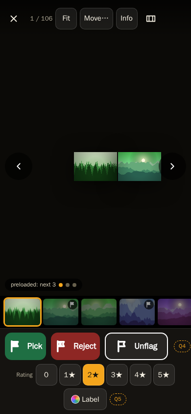 | 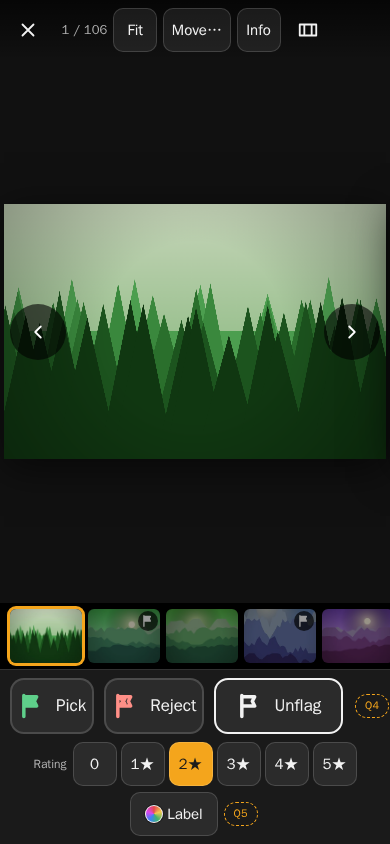 |

### Loupe on a desktop (H1, H3, M1, M5)

| Before | After |
|---|---|
| 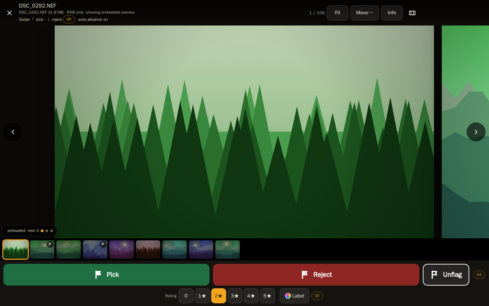 | 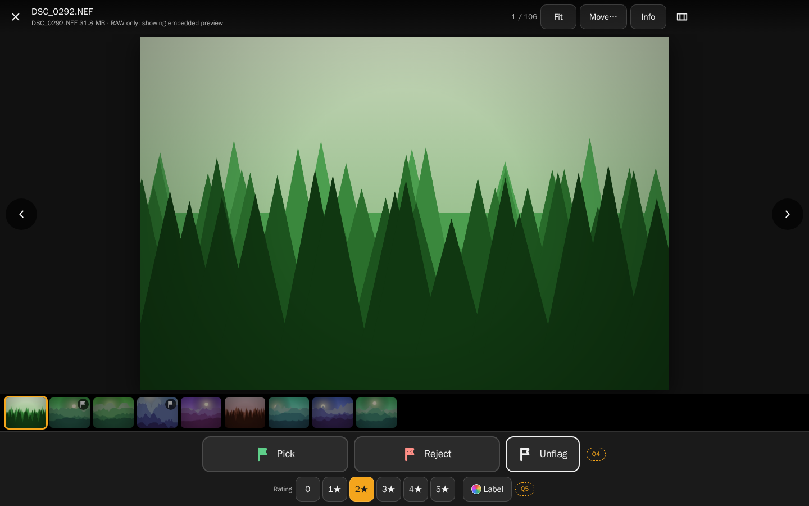 |

### Gesture guide on the first loupe open (M5)

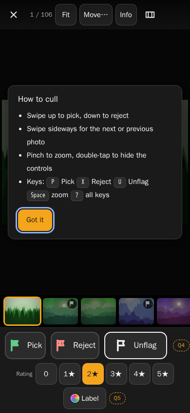

### Grid (H3, M2, M3, M8, M9)

| Before | After |
|---|---|
| 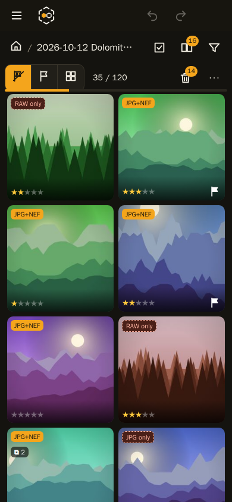 | 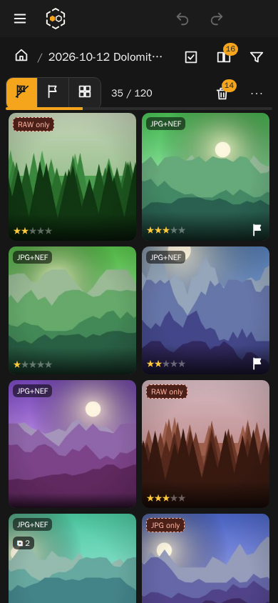 |
| 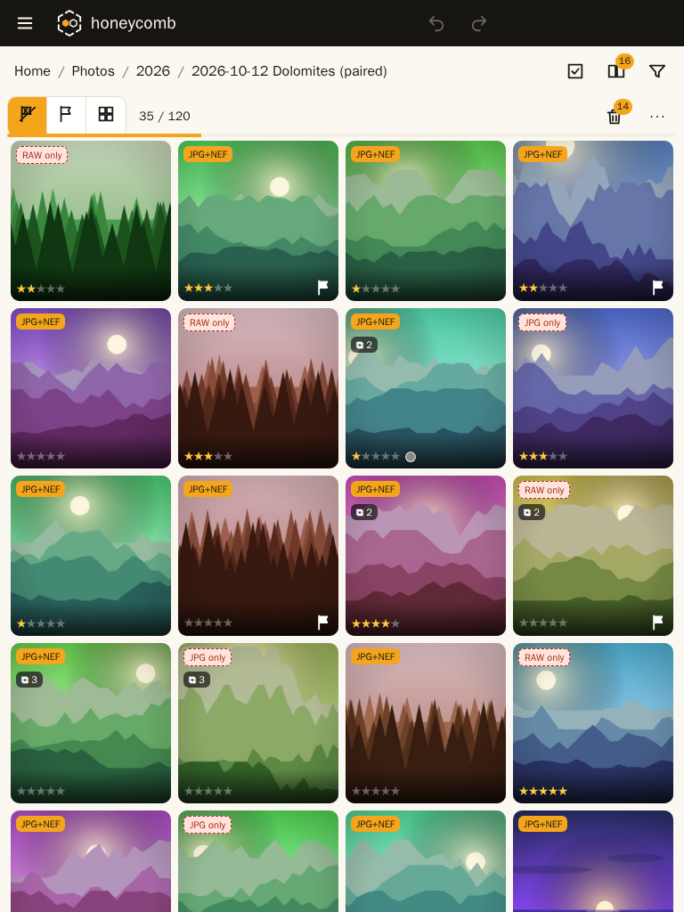 | 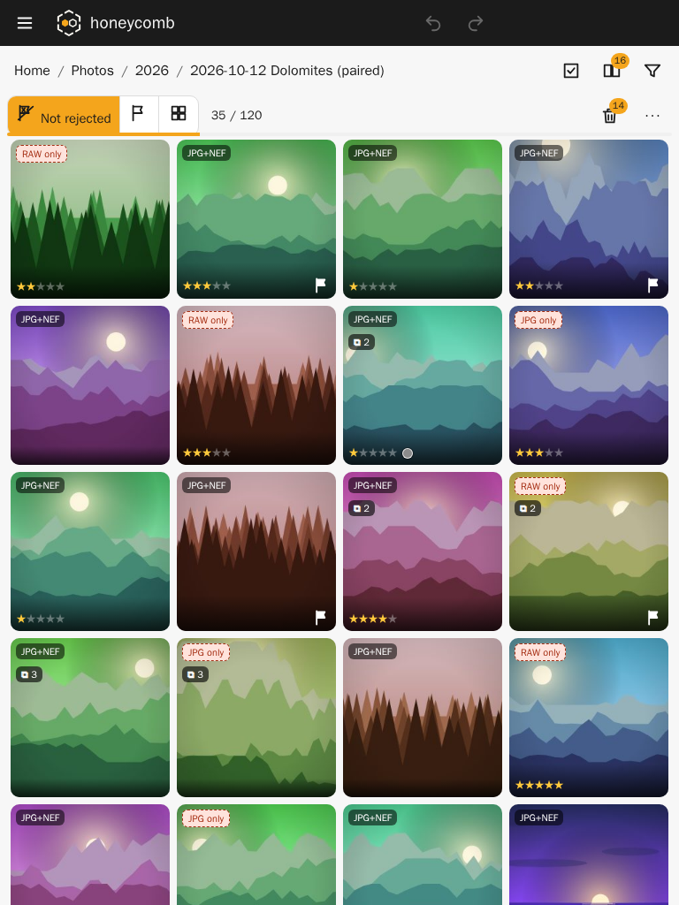 |

### First run (H2, M4, M10)

| Before | After |
|---|---|
| 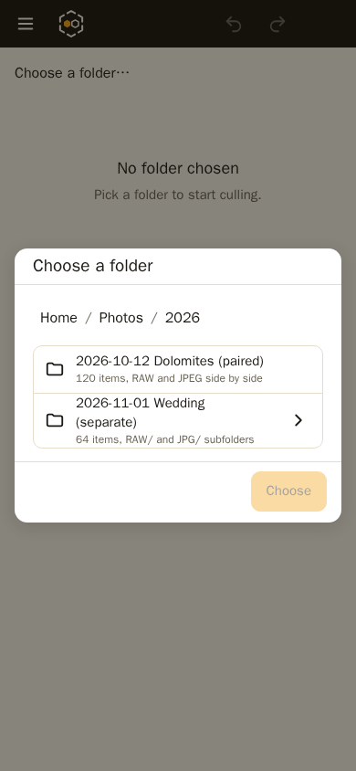 | 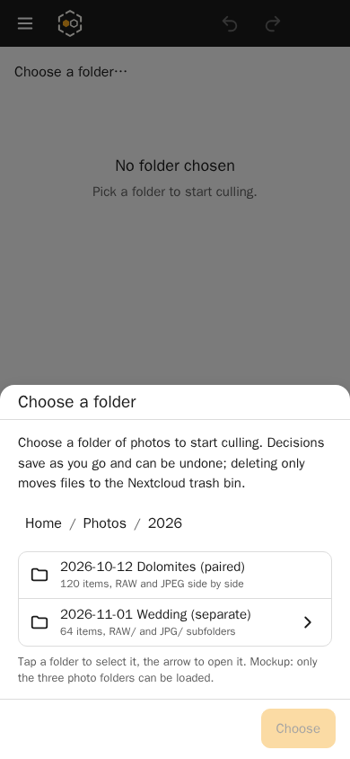 |

### Settings (H2, M10)

| Before | After |
|---|---|
| 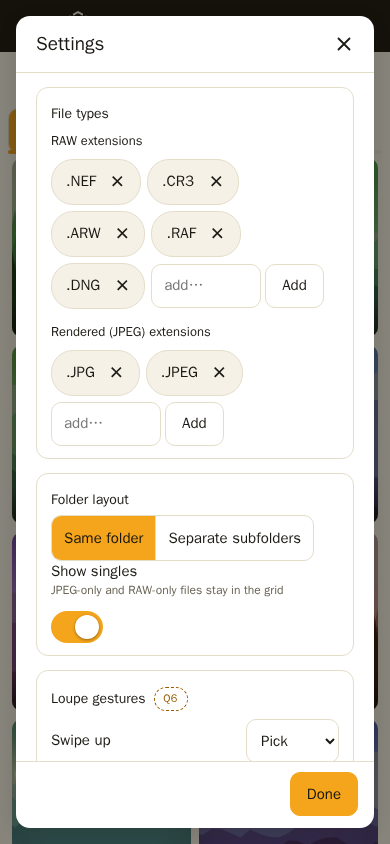 | 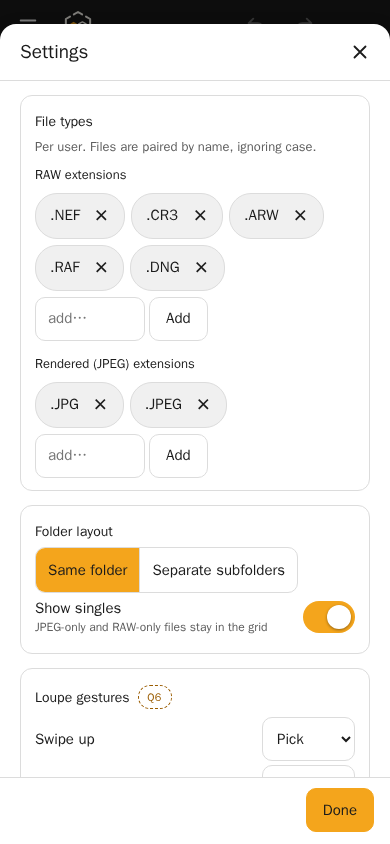 |

### Move dialog (H2, M7, M10)

| Before | After |
|---|---|
| 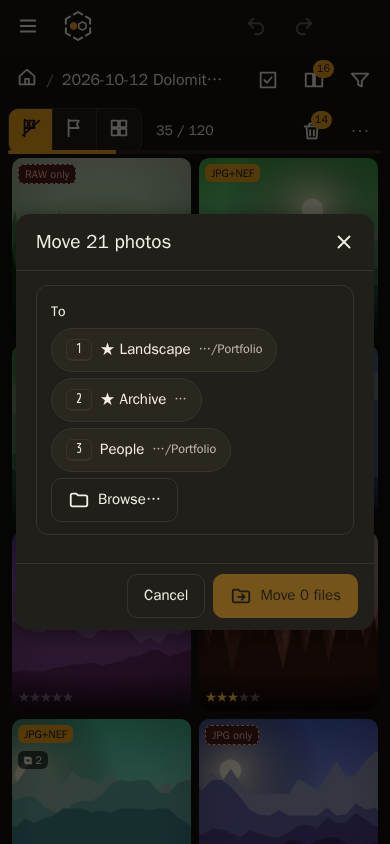 | 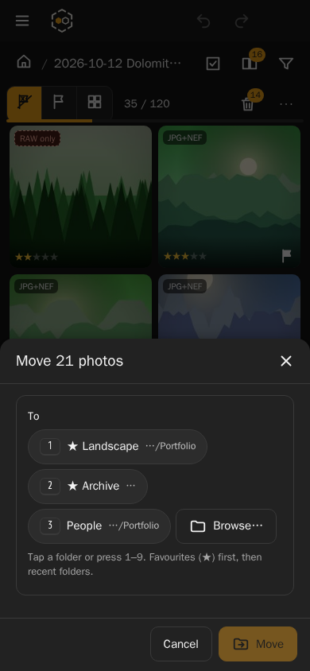 |

## Landscape loupe

The owner tested the mockup on the iPad (2026-11-09): in landscape the photo was too small and
the controls at the bottom took too much room. The fix is the rule in
[plan.md](plan.md#loupe-layout): the photo fills the screen, *Pick* and *Reject* float at the
side edges, everything else overlays the photo and hides when idle.

**Measured** with Playwright 1.63.0 (Chromium) in the dark theme, on photo 4 of the
*Dolomites* folder (3:2) and the first series. *Photo* is the fitted photo's area as a share of
the screen. *Controls* are the strips across the full width that the photo has to share:
before, the title row, the filmstrip and the bottom bar, all always shown; after, only the
overlays, which hide when idle. The flag buttons after are two 84 × 240 px buttons at the edges
(68 × 140 px on a phone) plus *Unflag*, outside the middle half of the screen.

| Screen | Loupe photo before → after | Loupe controls before → after | Series viewer photo before → after | Series viewer controls before → after |
|---|---|---|---|---|
| iPad 11″ landscape 1180 × 820 | 47 % → 92 % | 259 px always → 182 px, hidden when idle | 96 % → 96 % | 194 px, Pick and Reject hidden when idle → 116 px, Pick and Reject always shown |
| iPad 13″ landscape 1366 × 1024 | 60 % → 85 % | 259 px always → 182 px, hidden when idle | 89 % → 89 % | same as above |
| Phone landscape 844 × 390 | 8 % → 67 % | 259 px always → 182 px, hidden when idle | 69 % → 69 % | 194 px → 166 px (the row wraps), Pick and Reject always shown |
| Desktop 1440 × 900 | 46 % → 90 % | 259 px always → 182 px, hidden when idle | 94 % → 94 % | as on the iPad |
| iPad 11″ portrait 820 × 1180 | 45 % → 45 % | 259 px, unchanged | 46 % → 46 % | unchanged |
| Phone portrait 390 × 844 | 30 % → 30 % | 301 px, unchanged | 31 % → 31 % | unchanged |

The series viewer already showed its photo full screen with controls that hide; it now keeps
*Pick* and *Reject* in view while the rest hides, and its bottom row shrinks from 134 px to
56 px.

### Loupe on an iPad in landscape

| Before | After, controls shown | After, idle |
|---|---|---|
| 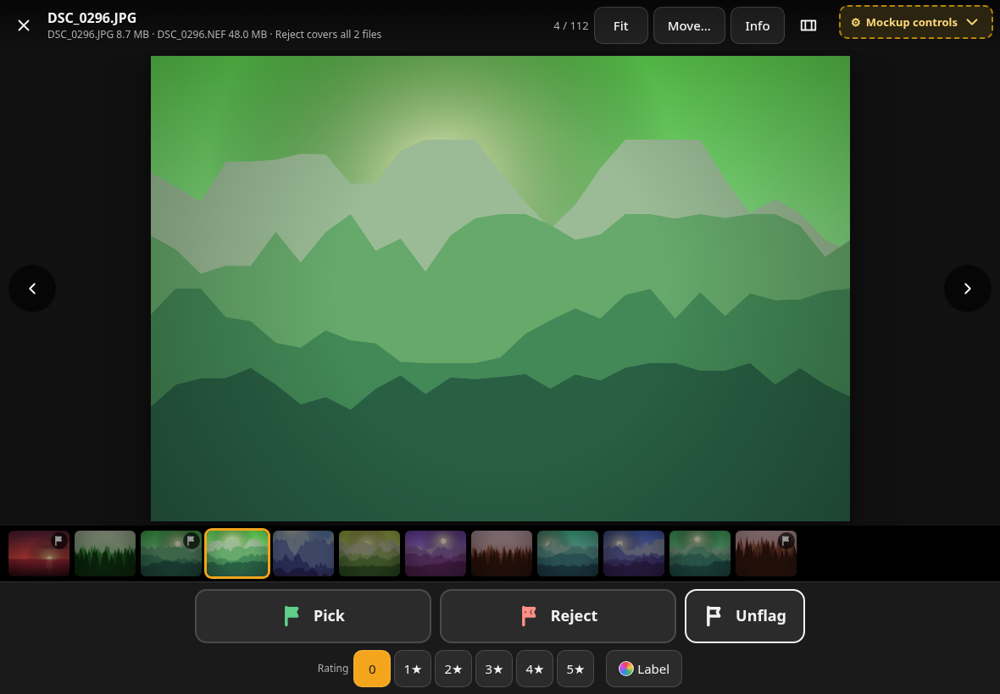 | 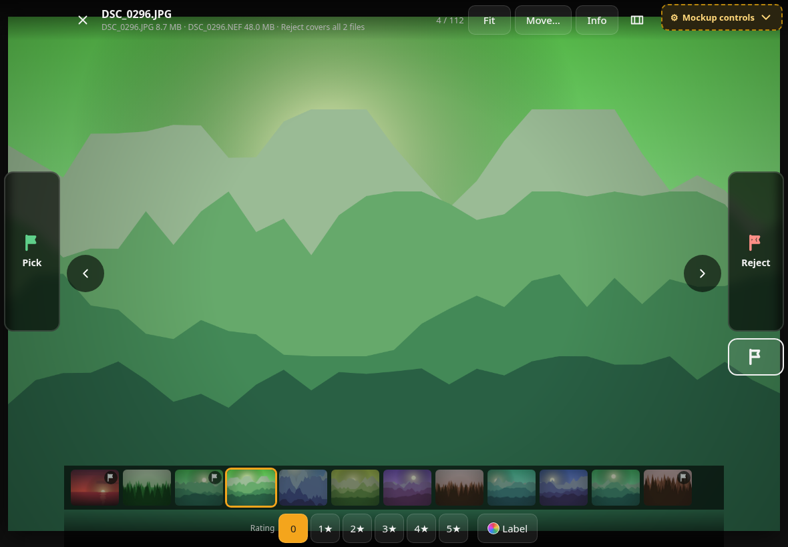 | 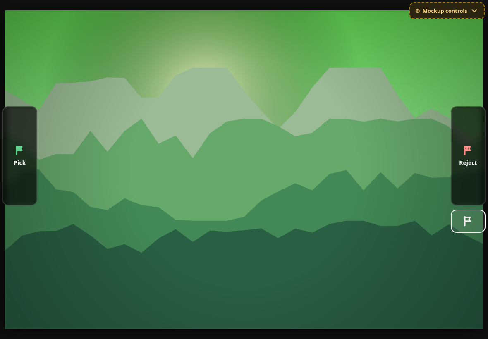 |

### Loupe on a phone in landscape

| Before | After, idle |
|---|---|
| 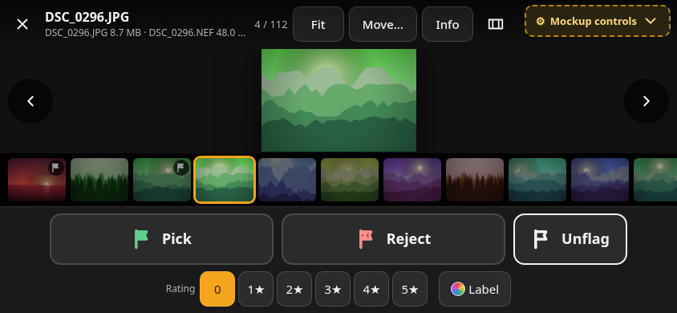 | 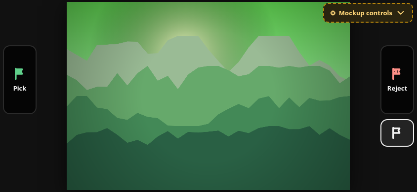 |

### Series viewer on an iPad in landscape

| Before | After, idle |
|---|---|
| 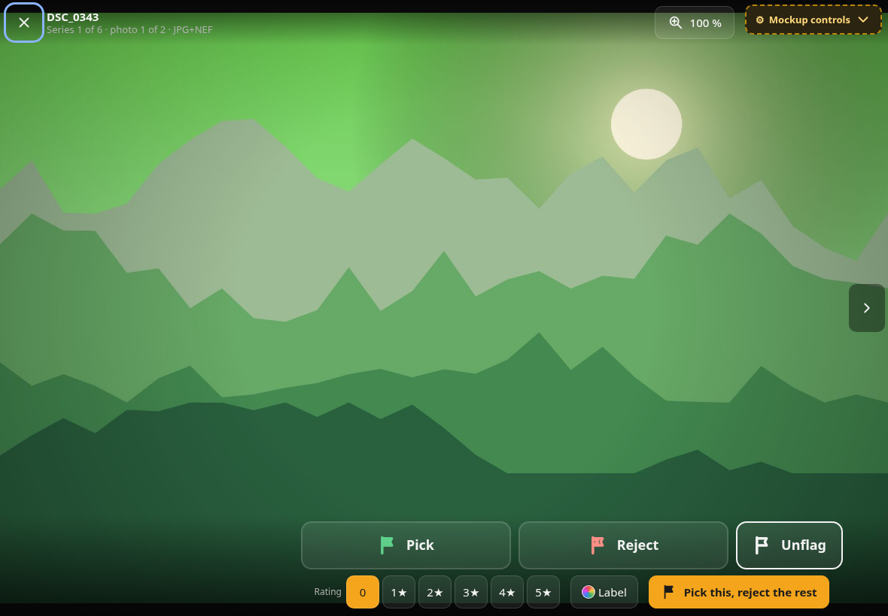 | 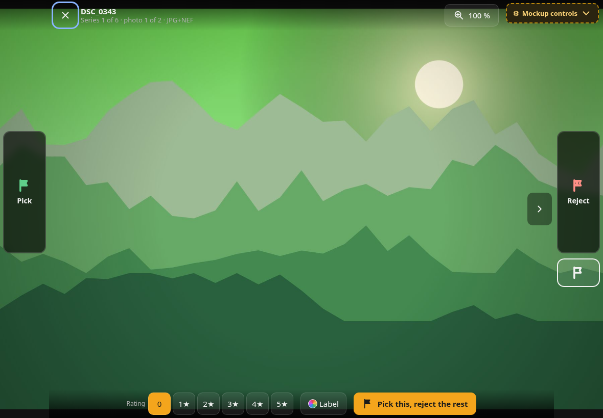 |

## What already works

- Every icon button has an accessible name.
- A visible 3 px focus ring in both themes.
- `prefers-reduced-motion` turns off every transition.
- Every decision shows a toast with *Undo*, and Ctrl+Z / Ctrl+Shift+Z work everywhere.
- Deleting moves to the trash bin, and the error report lists each failed file with *Retry*.
- The P, X, U and 0–5 keys match Lightroom and Photo Mechanic, so photographers already know them.

## Design direction

- **Colour:** neutral greys only, so nothing tints the photo. Honey is the accent for
  selection, the current item and the primary action, never a surface.

  | Token | Light | Dark |
  |---|---|---|
  | `--bg` | `#f7f7f7` | `#161616` |
  | `--card` / `--card-2` | `#ffffff` / `#f0f0f0` | `#222222` / `#2c2c2c` |
  | `--text` / `--muted` | `#1b1b1b` / `#5e5e5e` | `#f2f2f2` / `#a6a6a6` |
  | `--border` | `#dcdcdc` | `#3a3a3a` |

  The loupe and series viewer use theme-independent stage tokens: `--stage #111111`,
  `--stage-2 #1a1a1a`, `--stage-text #f2f2f2`, `--stage-muted #b0b0b0`. A pressed flag fills
  with `--pick-fill #1f7a46` or `--reject-fill #b3302c`; unpressed flag buttons are neutral
  with a coloured icon.
- **Type:** the system UI font stack, as Nextcloud uses; 15 px body, 13 px hints and metadata,
  17–19 px headings, weight 600–700 only for headings and pressed states.
- **Spacing:** a 4/8 px grid; 44 px minimum targets; the photo gets every pixel the chrome
  does not need.
- **Motion:** 150–350 ms ease-out, only to show where something went (swipe, toast, sheet);
  none under `prefers-reduced-motion`.
- **Phone:** dialogs are bottom sheets; the main actions sit in the lower half.
